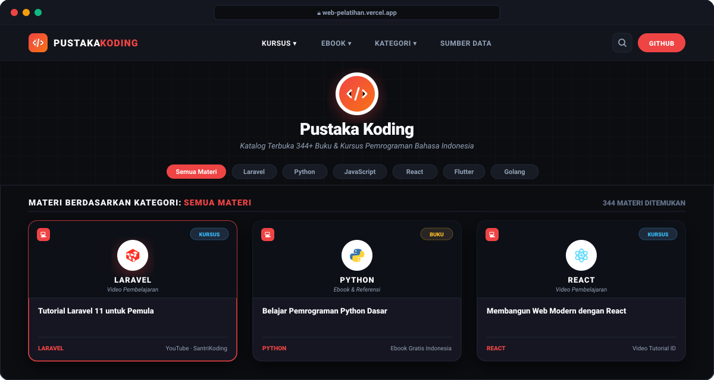

<div align="center">

# 📚 PUSTAKA KODING INDONESIA
### Katalog Terbuka Buku & Kursus Pemrograman Gratis Bahasa Indonesia

[](https://web-pelatihan.vercel.app)
[](https://creativecommons.org/licenses/by/4.0/)
[](https://web-pelatihan.vercel.app)
[](https://web-pelatihan.vercel.app)
[-orange?style=for-the-badge&logo=javascript&logoColor=white)](https://web-pelatihan.vercel.app)

<br/>

**[🌐 Buka Website Demo](https://web-pelatihan.vercel.app)** &bull;
**[📖 Repositori Sumber](https://github.com/EbookFoundation/free-programming-books)** &bull;
**[⚡ Jalankan Lokal](#-panduan-menjalankan-secara-lokal)** &bull;
**[🔄 Pembaruan Data](#-alur-kerja-pembaruan-data-pipeline)**

<br/>

<!-- PREVIEW SHOWCASE -->
<p align="center">
  
</p>

</div>

---

## 🌟 Tentang Proyek

**Pustaka Koding** adalah platform katalog materi belajar pemrograman gratis berbahasa Indonesia yang dirancang cepat, elegan, dan tanpa *dependency* eksternal. 

Data materi dikurasi langsung secara otomatis dari repositori komunitas global ternama **[EbookFoundation/free-programming-books](https://github.com/EbookFoundation/free-programming-books)** di bawah lisensi resmi **Creative Commons Attribution 4.0 (CC BY 4.0)**.

Antarmuka web ini mengadopsi estetika modern bernuansa *dark mode* yang terinspirasi oleh platform edukasi **[SantriKoding](https://santrikoding.com)**—lengkap dengan kartu materi bergaya editor kode, aksen merah yang elegan, serta logo profil asli dari masing-masing bahasa pemrograman dan kerangka kerja (framework).

---

## 🚀 Demo Langsung (Live Demo)

Aplikasi web telah terhubung dan otomatis dideploy melalui Vercel:

> ### 👉 **[https://web-pelatihan.vercel.app](https://web-pelatihan.vercel.app)**

*Bebas diakses publik kapan saja dari perangkat komputer, tablet, maupun ponsel pintar.*

---

## ✨ Fitur Unggulan

| Fitur | Deskripsi |
| :--- | :--- |
| ⚡ **Arsitektur Zero-Dependency** | Dibangun murni menggunakan **HTML5, CSS3, dan Vanilla JavaScript** tanpa framework frontend maupun build-tool yang memberatkan. Kecepatan muat instan (*instant load*). |
| 🔍 **Pencarian Cepat & Multi-Filter** | Pencarian instan *real-time* yang mencakup judul, deskripsi/penulis, hingga topik teknologi tanpa perlu me-reload halaman. |
| 🏷️ **Tab Navigasi Kursus & Ebook** | Filter satu klik untuk memisahkan antara **Kursus Video** (247 entri) dan **Buku Bacaan Digital** (97 entri). |
| 💎 **Logo Vektor Asli Teknologi** | Tiap kartu materi dilengkapi ikon vektor SVG asli (Laravel, Python, React, Flutter, Golang, Docker, TypeScript, Android, Vue, PHP, dll.). |
| 🎨 **UI Modern ala SantriKoding** | Desain berkarakter pengembang dengan *grid pattern*, tipografi tegas, kartu berlatar editor kode, dan efek *hover lift*. |
| 🌙 **Mode Gelap & Terang (Dual Theme)** | Mendukung tema gelap (*default*) dan tema terang, otomatis membaca preferensi sistem (`prefers-color-scheme`) dan tersimpan di `localStorage`. |
| 🔄 **Pipeline Parser Otomatis** | Dilengkapi script Python mandiri (`parse_fpb.py`) yang mengunduh dan mengekstrak materi Markdown terbaru langsung dari repositori resmi. |
| 🛡️ **Aman dari XSS** | Seluruh data yang dirender disanitasi menggunakan fungsi `escapeHtml` ketat untuk menjaga keamanan peramban. |

---

## 📊 Statistik & Cakupan Materi

Saat ini terdapat **344 materi terverifikasi** dalam **58 kategori teknologi**:

```
Total Materi : 344 Entri
├── Kursus Video : 247 Entri (71.8%)
└── Buku / Ebook :  97 Entri (28.2%)
```

### Sampel Topik Populer
| Topik | Jenis Tersedia | Contoh Materi |
| :--- | :--- | :--- |
| **JavaScript / TypeScript** | Kursus & Buku (34+) | Dasar JS, ES6, TypeScript Komprehensif |
| **Python & AI/ML** | Kursus & Buku (32+) | Python Dasar, Django, Flask, Machine Learning |
| **HTML, CSS & Frontend** | Kursus & Buku (24+) | Semantic HTML, CSS Grid, Flexbox, Bootstrap |
| **PHP & Laravel** | Kursus & Buku (36+) | Laravel 11, CodeIgniter, REST API PHP |
| **Mobile (Flutter/Android)** | Kursus & Buku (21+) | Flutter BLoC, Pemrograman Android Dasar |
| **Go (Golang)** | Kursus & Buku (12+) | Dasar Golang, Microservices, Concurrency |
| **DevOps & Cloud** | Kursus & Buku (22+) | Docker, Git, Kubernetes, Linux Sysadmin |

---

## 🏗️ Alur Kerja Arsitektur Data

```mermaid
flowchart LR
    A["EbookFoundation Repo (GitHub Raw)"] -->|urllib.request| B["parse_fpb.py (Python Parser)"]
    B -->|Regex Extraction| C[("data.json (344 entri)")]
    B -->|Embedded const D=[...]| D["index.html (Single Page App)"]
    B -->|Backup Copy| E["web-pelatihan.html"]
    D -->|Git Push| F["GitHub Repository"]
    F -->|Auto Deploy| G["Vercel Production Edge"]
```

1. **Pengunduhan Mentah:** `parse_fpb.py` mengunduh `free-programming-books-id.md` dan `free-courses-id.md` menggunakan library bawaan Python `urllib` (tanpa dependensi eksternal).
2. **Pembersihan & Ekstraksi:** Regex membedah heading `###`/`####` sebagai kategori dan mengekstrak item `* [Judul](url) - Keterangan`.
3. **Penyimpanan:** Data disimpan ke `data.json` serta disuntikkan secara statis ke dalam tag `<script>` pada `index.html` sebagai variabel `const D = [...]` untuk performa maksimal tanpa request API eksternal saat runtime.

---

## 💻 Panduan Menjalankan Secara Lokal

Tidak memerlukan instalasi `npm`, `node_modules`, ataupun web packager lainnya.

### 1. Kloning Repositori
```bash
git clone https://github.com/muhikram96798-cyber/web-pelatihan.git
cd web-pelatihan
```

### 2. Jalankan Langsung
Anda dapat langsung membuka file `index.html` di peramban favorit Anda:
- **Windows:** Klik dua kali pada `index.html`
- **Atau gunakan local server bawaan Python:**
```bash
python -m http.server 3000
```
Buka browser pada alamat: **`http://localhost:3000`**

---

## 🔄 Pembaruan Data Otomatis

Kapan pun repositori [EbookFoundation/free-programming-books](https://github.com/EbookFoundation/free-programming-books) diperbarui oleh komunitas, Anda dapat memperbarui seluruh data lokal hanya dengan satu perintah:

```bash
python parse_fpb.py
```

Output terminal:
```text
============================================================
  Parser Free Programming Books & Courses (Bahasa Indonesia)
============================================================
Mengunduh: https://raw.githubusercontent.com/...
Sukses! Total 344 materi berhasil diparse dan disimpan:
  • Buku   : 97 entri
  • Kursus : 247 entri
File JSON: data.json
File Web : web-pelatihan.html
File Vercel: index.html
============================================================
```

Setelah itu, unggah pembaruan ke GitHub:
```bash
git add data.json index.html web-pelatihan.html
git commit -m "chore: perbarui data materi dari EbookFoundation"
git push origin main
```
*Vercel akan otomatis melakukan redeploy dalam hitungan detik.*

---

## 📂 Struktur Direktori Proyek

```plaintext
web-pelatihan/
├── assets/
│   └── preview.svg             # Mockup visual demo beresolusi tinggi untuk README
├── data.json                   # Hasil ekstraksi database 344 materi (format JSON)
├── index.html                  # File utama aplikasi web (HTML + CSS + JS inline untuk Vercel)
├── web-pelatihan.html          # Salinan independen file aplikasi web
├── parse_fpb.py                # Pipeline script Python untuk mengunduh & mem-parse data
├── prompt-web-pelatihan.md     # Spesifikasi prompt kebutuhan awal proyek
└── README.md                   # Dokumentasi resmi proyek
```

---

## 📜 Sumber Data, Lisensi & Hak Cipta

- **Data Katalog:** Bersumber dari komunitas terbuka **[EbookFoundation/free-programming-books](https://github.com/EbookFoundation/free-programming-books)** di bawah lisensi **[Creative Commons Attribution 4.0 International (CC BY 4.0)](https://creativecommons.org/licenses/by/4.0/)**.
- **Materi Eksternal:** Seluruh hak cipta artikel, video tutorial YouTube, buku, dan materi kursus merupakan milik masing-masing kreator, penulis, dan penerbit aslinya. Platform ini berfungsi sebagai direktori kurasi referensi publik.
- **Inspirasi Antarmuka:** Desain antarmuka terinspirasi oleh platform edukasi **[SantriKoding.com](https://santrikoding.com)**.
- **Kode Program Web:** Dilindungi di bawah lisensi **[MIT License](LICENSE)** &bull; Bebas digunakan, dipelajari, dan dikembangkan kembali untuk keperluan edukasi.

---

<div align="center">
  <sub>Dibangun dengan dedikasi untuk memajukan talenta digital & pengembang perangkat lunak Indonesia.</sub>
</div>
